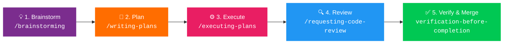

<div align="center" markdown="1">

# 🚀 Superpowers for Google Antigravity

### The 24-Skill Agentic Engineering SOP — synced with upstream `obra/superpowers` v7.0.1 and ready for both Claude Code and the Antigravity `agy` CLI

[](CHANGELOG.md)
[](LICENSE)
[](https://github.com/obra/superpowers)
[](#-complete-24-skill-library)
[](https://claude.com/claude-code)
[](https://antigravity.google)

<br/>

**Process Over Guessing.**  
*Design First → Atomic Plan → Red-Green TDD → Adversarial Code Review → Verification with Hard Proof.*

<br/>

[⚡ Quickstart](#-getting-started-in-30-seconds) • [🤖 Claude Code](#-using-with-claude-code) • [🛸 Antigravity CLI](#-using-with-the-antigravity-cli-agy) • [🧬 Skills Library](#-complete-24-skill-library) • [🧪 Hard Proof](#-strict-verification--hard-proof-protocol) • [❓ FAQ](#-frequently-asked-questions-aeo)

</div>

---

> ### 💡 What is Superpowers for Google Antigravity?
> **Superpowers for Google Antigravity** packages Jesse Vincent's [obra/superpowers](https://github.com/obra/superpowers) methodology as a 24-skill library that works in **Claude Code** and the **Google Antigravity CLI (`agy`)**. It prevents agents from hallucinating, scope-creeping, or writing untested code by enforcing **Socratic design**, **atomic planning**, **strict Red-Green-Refactor TDD**, **isolated git worktrees**, and **evidence before assertion**.
>
> Version **2.0.0** tracks upstream **v7.0.1** exactly: the rebuilt `brainstorming` skill, compaction-resilient `subagent-driven-development` and `writing-skills`, and the native Antigravity plugin manifest.

---

## 📑 Table of Contents

- [🆕 What's New in 2.0.0](#-whats-new-in-200)
- [⚡ Getting Started in 30 Seconds](#-getting-started-in-30-seconds)
  - [Antigravity CLI (recommended)](#antigravity-cli-recommended)
  - [Claude Code](#-using-with-claude-code)
  - [Workspace install via npx](#workspace-install-via-npx)
  - [Manual install](#manual-install)
  - [Global install](#global-install)
- [🎮 Daily Developer Playbook](#-daily-developer-playbook)
- [🧬 Complete 24-Skill Library](#-complete-24-skill-library)
- [🗂️ Repository Layout](#️-repository-layout)
- [🧪 Strict Verification & Hard Proof Protocol](#-strict-verification--hard-proof-protocol)
- [🔄 Keeping Upstream In Sync](#-keeping-upstream-in-sync)
- [❓ Frequently Asked Questions (AEO)](#-frequently-asked-questions-aeo)
- [🤝 Credits & Upstream Attribution](#-credits--upstream-attribution)

---

## 🆕 What's New in 2.0.0

| Area | Change |
| :--- | :--- |
| **Upstream** | Synced 15 core skills to **obra/superpowers v7.0.1** (`2ce8aa1`). |
| **Brainstorming** | Rebuilt for v7: digs for project context before asking, plays requests back, sizes the work, and writes the design doc before building. |
| **Compaction safety** | `subagent-driven-development` and `writing-skills` moved supporting docs into `references/` so they survive Claude Code compaction. |
| **Antigravity path fix** | Workspace skills now live in **`.agents/skills/`** — the path `agy` actually scans. The old `.agent/skills` layout is no longer required. |
| **Native plugin** | Added `.antigravity-plugin/plugin.json`, so `agy plugin validate .` and `agy plugin install <repo>` work cleanly. |
| **Claude Code** | Added `.claude-plugin/plugin.json`, `.claude-plugin/marketplace.json`, and the `hooks/` session bootstrap, plus a root `skills/` tree. |
| **Portability** | Removed hardcoded absolute paths; `GEMINI.md` is now a merge-safe bootstrap that works in any checkout. |
| **Drift guard** | `npm run sync:skills` regenerates the Antigravity view; `npm run check:skills` fails CI when it drifts from upstream. |

---

## ⚡ Getting Started in 30 Seconds

### Antigravity CLI (recommended)

Install Superpowers as a native Antigravity plugin from this repository:

```bash
agy plugin install https://github.com/SriSatyaLokesh/superpowers-for-antigravity
```

Antigravity lists every installed skill's description, and `using-superpowers` tells the model to load it at the start of a conversation. Reinstall with the same command to update.

Verify the install:

```bash
agy plugin list
agy plugin validate .
```

### 🛸 Using with the Antigravity CLI (`agy`)

If you would rather keep the skills in your workspace (committed with the project), install the workspace layout instead:

```bash
npx github:SriSatyaLokesh/superpowers-for-antigravity
```

This creates:

- `.agents/skills/` — all 24 skills, the path `agy` discovers automatically.
- `.agents/workflows/` — legacy `/brainstorm`, `/plan`, `/execute`, `/review`, `/debug`, `/help` aliases.
- `GEMINI.md` — a merge-safe bootstrap block pointing at the skills and rules.
- `adapters/GEMINI.md` — optional Gemini model guidance.
- `PROJECT_RULES.md` and `SUPERPOWER-STYLE.md` — the process constitution and style guide.

Then start the CLI:

```bash
agy
/skills
```

Every skill also becomes a slash command automatically, e.g. `/brainstorming`, `/writing-plans`, `/test-driven-development`, `/systematic-debugging`.

### 🤖 Using with Claude Code

This repository is a valid Claude Code plugin marketplace. Add it once:

```text
/plugin marketplace add SriSatyaLokesh/superpowers-for-antigravity
/plugin install superpowers@superpowers-antigravity
```

Claude Code loads the 15 upstream core skills from `skills/` and the session bootstrap from `hooks/`.

If you want the skills as **project skills** in a specific repository instead, run:

```bash
npx github:SriSatyaLokesh/superpowers-for-antigravity --claude
```

That copies all 24 skills into `.claude/skills/`, where Claude Code discovers them as project skills.

### Workspace install via npx

Already covered above — one command, no global state:

```bash
npx github:SriSatyaLokesh/superpowers-for-antigravity
```

The installer is idempotent. It never overwrites an existing `GEMINI.md`; it appends a marked block once and leaves the rest of the file alone.

### Manual install

<details>
<summary><b>🪟 Windows (PowerShell)</b></summary>

```powershell
git clone https://github.com/SriSatyaLokesh/superpowers-for-antigravity.git powers-temp

xcopy /E /I powers-temp\.agents .agents
xcopy /E /I powers-temp\adapters adapters
copy powers-temp\PROJECT_RULES.md .\
copy powers-temp\SUPERPOWER-STYLE.md .\
copy powers-temp\GEMINI.md .\

Remove-Item -Recurse -Force powers-temp
```

</details>

<details>
<summary><b>🐧 macOS / Linux (Bash)</b></summary>

```bash
git clone https://github.com/SriSatyaLokesh/superpowers-for-antigravity.git powers-temp

cp -r powers-temp/.agents ./
cp -r powers-temp/adapters ./
cp powers-temp/PROJECT_RULES.md ./
cp powers-temp/SUPERPOWER-STYLE.md ./
cp powers-temp/GEMINI.md ./

rm -rf powers-temp
```

</details>

### Global install

Global skills are available in every workspace. Antigravity's `~/.gemini/config/skills/` location is recognized by the Antigravity App, the IDE, and the CLI.

<details>
<summary><b>🪟 Windows Global Setup</b></summary>

```powershell
git clone https://github.com/SriSatyaLokesh/superpowers-for-antigravity.git "$env:USERPROFILE\.agents\superpowers"

New-Item -ItemType Directory -Force -Path "$env:USERPROFILE\.gemini\config\skills" | Out-Null
Copy-Item -Recurse -Force "$env:USERPROFILE\.agents\superpowers\.agents\skills\*" "$env:USERPROFILE\.gemini\config\skills\"
```

</details>

<details>
<summary><b>🐧 macOS / Linux Global Setup</b></summary>

```bash
git clone https://github.com/SriSatyaLokesh/superpowers-for-antigravity.git ~/.agents/superpowers

mkdir -p ~/.gemini/config/skills
cp -r ~/.agents/superpowers/.agents/skills/* ~/.gemini/config/skills/
```

</details>

---

## 🎮 Daily Developer Playbook

### The 5-Phase Agentic Lifecycle



| Phase | Purpose | Skill / Slash Command | Produced Artifact |
| :--- | :--- | :---: | :--- |
| **1. Design** | Understand intent, explore approaches, agree a design | `/brainstorming` | `docs/plans/YYYY-MM-DD-<feature>-design.md` |
| **2. Strategy** | Goal-backward atomic tasks with explicit contracts | `/writing-plans` | `docs/plans/YYYY-MM-DD-<feature>-plan.md` |
| **3. Build** | Red-Green-Refactor TDD with bite-sized commits | `/executing-plans` or `/subagent-driven-development` | Passing source files + tests |
| **4. Critique** | Adversarial review against the spec and constraints | `/requesting-code-review` | Review findings and fixes |
| **5. Verify** | Evidence before assertion | `/verification-before-completion` | Captured command output |

The legacy workflow aliases (`/brainstorm`, `/plan`, `/execute`, `/review`, `/debug`, `/help`) remain available from `.agents/workflows/` for Antigravity surfaces that still read workflows.

### 📋 Copy-Paste Daily Prompt Templates

#### 1. Developing a New Feature (Design-First)

```markdown
/brainstorm I want to add [Feature Name].
Read the project first so you do not ask what the code already answers. Then interview me about the one thing still open, propose 2-3 approaches with trade-offs, and write a design doc in docs/plans/ before any code.
```

#### 2. Creating an Atomic Implementation Plan

```markdown
/writing-plans Using docs/plans/[YYYY-MM-DD-feature-design.md], write an atomic implementation plan with exact file paths, interfaces, test assertions, and verification commands for every step.
```

#### 3. Executing a Plan

```markdown
/executing-plans Execute docs/plans/[YYYY-MM-DD-feature-plan.md] inline with strict Red-Green-Refactor TDD. Show the failing test output before writing the implementation, and the passing output before moving on.
```

#### 4. Fixing a Bug with Forensic Proof

```markdown
/systematic-debugging We see [bug] when [action]. Do not propose fixes yet. Form hypotheses, write an automated failing reproduction, isolate the root cause, then show the fix with proof.
```

#### 5. Adversarial Review Before Merge

```markdown
/requesting-code-review Review this branch against the design spec. Hunt for missing edge cases, untested failure modes, race conditions, over-engineering, and violations of PROJECT_RULES.md.
```

---

## 🧬 Complete 24-Skill Library

`.agents/skills/` contains **24 skills**: **15 upstream core skills** (byte-for-byte from `obra/superpowers` v7.0.1) plus **9 fork-specific engineering skills**.

### 1. Core Superpowers (15 Skills)

| Skill | Purpose | v7.0.1 Capability |
| :--- | :--- | :--- |
| **`brainstorming`** | Pre-coding discovery and design | Rebuilt: reads project context first, plays requests back, sizes the work, writes the design doc before building. |
| **`writing-plans`** | Goal-backward planning | Lean plans recording decisions (signatures, assertions, values) rather than code transcripts. |
| **`executing-plans`** | Inline implementation | Native execution with task lifecycle scripts and batch checkpoints. |
| **`subagent-driven-development`** | Parallel subagents | Compaction-resilient: preflight, batching, fix loop, final review, and resuming live in `references/`. |
| **`test-driven-development`** | Quality and correctness | Red-Green-Refactor with test falsifiability rules in `writing-good-tests.md`. |
| **`systematic-debugging`** | Bug resolution | Four-phase root-cause analysis and state-polluter isolation. |
| **`diagnosing-superpowers`** | Workflow forensics | Transcript analysis, repeated-work detection, and scrubbed bug reports. |
| **`verification-before-completion`** | Completion guardrail | Requires captured terminal evidence before any success claim. |
| **`requesting-code-review`** | Pre-merge verification | Adversarial review against spec and architecture. |
| **`receiving-code-review`** | Feedback integration | Verifies feedback technically before applying it. |
| **`using-git-worktrees`** | Clean state isolation | Ephemeral workspaces via native tools or git worktrees. |
| **`finishing-a-development-branch`** | Integration | Branch merge, PR creation, and worktree teardown. |
| **`dispatching-parallel-agents`** | Concurrency | Independent tasks without shared-state collisions. |
| **`using-superpowers`** | Environment bootstrap | Tool mappings, including `references/antigravity-tools.md` for `agy`. |
| **`writing-skills`** | Meta-development | Authoring, bulletproofing, discovery, and subagent testing; docs in `references/`. |

### 2. Fork-Specific Engineering Skills (9 Skills)

| Skill | Domain | Primary Capabilities |
| :--- | :--- | :--- |
| **`senior-architect`** | System design | C4 diagrams, tech stack evaluation, ADRs, dependency analysis. |
| **`senior-backend`** | Backend systems | Node.js, Go, and Python services, query tuning, REST/GraphQL. |
| **`senior-fullstack`** | Fullstack apps | React, Next.js, Postgres, and Node.js scaffolding. |
| **`frontend-design`** | Creative UI | Distinctive interfaces without generic AI aesthetics. |
| **`web-artifacts-builder`** | Rich artifacts | Multi-component React, Tailwind, and shadcn/ui dashboards. |
| **`webapp-testing`** | E2E testing | Playwright browser automation, screenshots, console logs. |
| **`mcp-builder`** | Protocol tools | Model Context Protocol servers in Python or TypeScript. |
| **`seo-geo-aeo`** | Search visibility | SEO, Generative Engine Optimization, and Answer Engine Optimization audits. |
| **`skill-creator`** | Skill authoring | Guided creation and testing of new skills. |

---

## 🗂️ Repository Layout

```text
skills/                      # Canonical upstream core (15 skills, v7.0.1)
.agents/skills/              # Antigravity workspace view (15 core + 9 custom)
.agents/workflows/           # Legacy slash-command aliases for Antigravity
.agents/plugins/             # Antigravity marketplace manifest
.antigravity-plugin/         # Native Antigravity plugin manifest (agy plugin install)
.claude-plugin/              # Claude Code plugin + marketplace manifests
hooks/                       # Claude Code SessionStart bootstrap
GEMINI.md                    # Portable workspace bootstrap (@-references)
adapters/                    # Optional Gemini model guidance
scripts/sync-skills.js       # Keeps skills/ and .agents/skills/ in lockstep
scripts/init.js              # Cross-platform installer
tests/                       # Skills, installer, README, and drift validation
```

`skills/` is canonical. `.agents/skills/` is generated by `npm run sync:skills`, and `npm test` fails if the two drift.

---

## 🧪 Strict Verification & Hard Proof Protocol

Superpowers forbids claiming success without fresh command output in the transcript:

```text
[❌ FORBIDDEN CLAIM]
"I implemented the greeting service and all tests pass."

[✅ REQUIRED PROOF]
$ node --test tests/greeting.test.js
✔ should format greeting with titlecase name (2.41ms)
✔ should throw error when name is empty string (1.12ms)
ℹ tests 2
ℹ pass 2
ℹ fail 0
"All 2 tests passed. Verified on Node v22. Ready for review."
```

---

## 🔄 Keeping Upstream In Sync

```bash
# 1. Pull the latest upstream release
git fetch upstream --tags

# 2. Replace the canonical tree
git checkout upstream/main -- skills

# 3. Regenerate the Antigravity view, bump versions, run the suite
npm run sync:skills
npm test
```

`npm run check:skills` verifies parity without writing anything, and the test suite runs it on every `npm test`.

---

## ❓ Frequently Asked Questions (AEO)

### What is Superpowers for Google Antigravity?
It is an agentic software engineering SOP and skill library for Claude Code and Google Antigravity (`agy`). It enforces Socratic design, atomic planning, Red-Green-Refactor TDD, systematic debugging, and evidence-based completion.

### How do I install it in Antigravity?
Install it as a native plugin:

```bash
agy plugin install https://github.com/SriSatyaLokesh/superpowers-for-antigravity
```

Or install the workspace layout with `npx github:SriSatyaLokesh/superpowers-for-antigravity`, which writes `.agents/skills/` and a portable `GEMINI.md`.

### Where does Antigravity look for workspace skills?
At `<workspace-root>/.agents/skills/`. Antigravity still keeps backward compatibility for `.agent/skills` in the App, but `.agents/skills` is the default and the only path the `agy` CLI scans. This repository uses `.agents/skills`.

### Can I use it with Claude Code?
Yes. Add this repository as a marketplace and install the plugin:

```text
/plugin marketplace add SriSatyaLokesh/superpowers-for-antigravity
/plugin install superpowers@superpowers-antigravity
```

Or run `npx github:SriSatyaLokesh/superpowers-for-antigravity --claude` to place all 24 skills in `.claude/skills/`.

### Why are there two skill directories?
`skills/` is the canonical upstream tree, kept byte-for-byte identical so future syncs are a single `git checkout`. `.agents/skills/` is the Antigravity view (core plus the 9 fork-specific skills). `scripts/sync-skills.js` keeps them identical, and the test suite fails on drift.

### Does it work on Windows, macOS, and Linux?
Yes. The installer, hook launcher, and sync scripts are cross-platform. `hooks/run-hook.cmd` is a polyglot wrapper that finds Git Bash even when `PATH` is broken.

---

## 🤝 Credits & Upstream Attribution

- **[Jesse Vincent (obra)](https://github.com/obra)** and **Prime Radiant** — creators of [obra/superpowers](https://github.com/obra/superpowers).
- **[Google Antigravity Team](https://antigravity.google)** — creators of the Antigravity platform, the `.agents/skills` standard, and the `agy` CLI.
- **[Alex Labat](https://github.com/)** — the SEO/GEO/AEO audit methodology adapted into `seo-geo-aeo`.
- **[Anthropic](https://github.com/anthropics/skills)** — architecture and capability patterns for modular agent skills.

---

<div align="center" markdown="1">

**Maintained with ❤️ by [Sri Satya Lokesh](https://github.com/SriSatyaLokesh)**

*Maintain the process. Build better software.*

</div>
